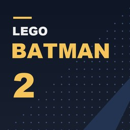

# LEGO Batman 2 NX

Неофициальный порт LEGO Batman 2 для Nintendo Switch. Установщик подготавливает файлы вашей копии игры и добавляет плитку запуска в HOME.

**[Скачать ZIP для microSD](https://github.com/derzhivkurse/lego-batman2-nx/releases/download/installer/lb2-installer-sd.zip)** · [Скачать NRO](https://github.com/derzhivkurse/lego-batman2-nx/releases/download/installer/lb2-installer.nro) · [Инструкция](INSTALL.md) · [Telegram](https://t.me/derzhivkurse_games)

## Что понадобится

- Nintendo Switch с Atmosphère и Homebrew Menu в режиме приложения.
- Своя копия LEGO Batman 2 для Xbox 360. Поддерживается издание **USA**, Title ID `57520817`, Media ID `1BF17B45`.
- Локально собранный игровой `lego-batman2-nx.nro`.

Распакуйте ZIP в корень карты, добавьте игровой NRO и файлы своего диска, затем откройте **LB2 Installer** и нажмите **A**. После `Ready` запускайте **LEGO Batman 2** с плитки HOME. [Пути на карте и пошаговая установка](INSTALL.md#если-игровой-nro-уже-есть)

Если игрового NRO ещё нет, его нужно собрать из своего ISO на компьютере. Публичный предварительный выпуск содержит установщик для Switch. Комплект локальной сборки готовится отдельно. [Что нужно для сборки](INSTALL.md#сборка-nro-из-своего-iso-на-компьютере)

## Поддержка и обновления

По ошибкам и вопросам пишите в Telegram. Укажите модель Switch и что делали перед сбоем. Для установки приложите `installer.log`, для игры — последний `logs/lego_batman2_*.log`. [Telegram](https://t.me/derzhivkurse_games) · [Как включить логи](INSTALL.md#как-включить-логи)

Регистрация плитки и запуск с подготовленной карты проверены на Switch Lite. Ссылки на файлы, SHA‑256 и лицензии есть в выпуске. [Страница выпуска](https://github.com/derzhivkurse/lego-batman2-nx/releases/tag/installer)
